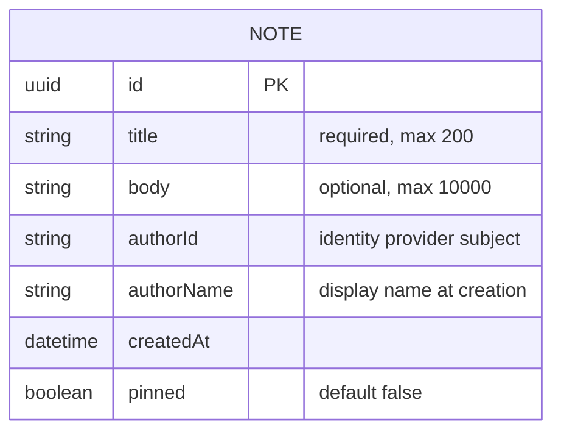

# Domain model

Team Notes holds one entity: a note shared by the whole team. Members are people known to the identity provider, so only their id and display name are kept on the note.

- Every note is visible to every member; there are no private notes.
- List order: pinned notes first, then unpinned, each newest first by `createdAt`.